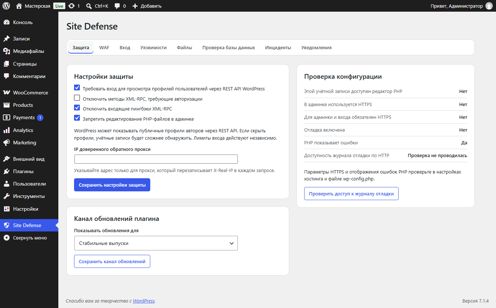
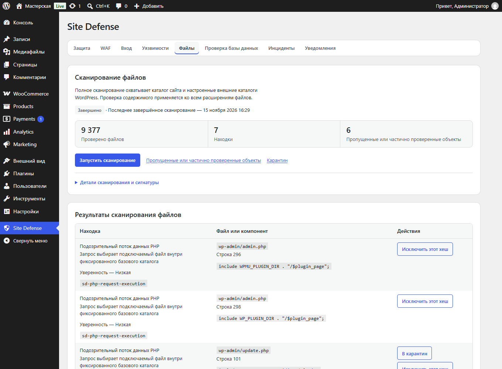
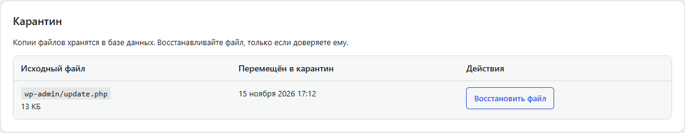
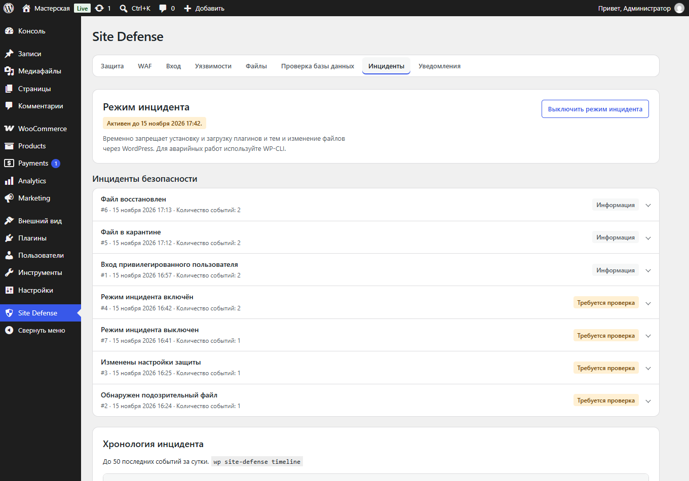

# Site Defense

Плагин безопасности для WordPress. Ограничивает подбор паролей, выявляет известные уязвимости и подозрительные изменения, помогает расследовать инциденты и восстанавливать сайт.

**[Скачать стабильную версию](https://github.com/KITH-web-studio/kith-site-defense/releases/latest/download/site-defense.zip)** · [Документация](docs/README.md) · [Скриншоты](#скриншоты) · [Что нового](CHANGELOG.md)

## Возможности

| Задача | Что умеет Site Defense |
| --- | --- |
| Защитить вход | Ограничение попыток входа, двухфакторная аутентификация, отдельный адрес входа и настройки доступа к профилям через REST API. |
| Проверить уязвимости | Локальная база Wordfence Intelligence, опциональная сверка с WPVulnerability и приоритет уязвимостей из CISA KEV. |
| Найти изменения | Сканирование файлов и контрольных сумм, аудит привилегированных аккаунтов, WP-Cron, внедрённых скриптов и редиректов. |
| Отреагировать | WAF с режимом наблюдения, карантин, точечное восстановление, журнал инцидентов и уведомления по email, в Telegram или через webhook. |
| Расследовать | WP-CLI и локальный MCP для сбора свидетельств, подготовки плана очистки и проверки результата. |

## Требования

- **WordPress 6.8 и PHP 8.2** или новее. Поддерживается обычная установка с одним сайтом.
- **PHP Sodium** нужен для подписанных обновлений и импорта пакетов. Для настройки 2FA нужны Sodium и HTTPS, для восстановления официальных файлов — ZipArchive.
- WooCommerce опционален. Обновление и сохранность тестового заказа проверены на WooCommerce 11.3.0 с HPOS.
- Интерфейс доступен на русском, украинском и английском.

## Быстрый старт

1. Скачайте `site-defense.zip` со [страницы стабильного релиза](https://github.com/KITH-web-studio/kith-site-defense/releases/latest).
2. В WordPress откройте **Плагины → Добавить плагин → Загрузить плагин**, выберите ZIP и активируйте Site Defense.
3. Откройте **Site Defense → Файлы** и запустите сканирование. Затем откройте **Проверка базы данных** и запустите аудит.
4. При необходимости выберите канал в **Уведомлениях** и отправьте тестовое сообщение.

Следующие стабильные версии появятся в штатном списке обновлений WordPress. Токен GitHub на сайте не нужен. [Установка, обновление и первые настройки](docs/installation.md)

## Скриншоты

Site Defense из текущих исходников в русской админке локального магазина WooCommerce. На снимках видны сохранённые настройки, полный проход сканера и действия, выполненные в интерфейсе.

### Защита

Настройки доступа к профилям через REST API, XML-RPC, редактора PHP и канала обновлений.

### Результаты сканирования

Сводка завершённой проверки и причины находок. Эвристические совпадения на снимке относятся к штатным файлам WordPress и требуют проверки контекста.

### Карантин

На локальной копии магазина штатный файл переместили в карантин. После проверки его восстановили и сверили SHA‑256 с оригиналом.

### Режим инцидента

Вкладка показывает срок действия режима и список событий. Подробности и действия открываются внутри выбранной записи.

## Руководства

- [Защита входа, WAF и источники уязвимостей](docs/protection.md)
- [Сканирование, аудит базы и карантин](docs/scanning.md)
- [Уведомления и независимый контроль](docs/notifications.md)
- [Расследование и восстановление после инцидента](docs/recovery.md)
- [Подключение MCP](docs/mcp.md) и [справочник WP-CLI](docs/wp-cli.md)
- [Сборка, подпись и публикация релизов](docs/releases.md)

Для ошибки или вопроса откройте [GitHub Issue](https://github.com/KITH-web-studio/kith-site-defense/issues). Укажите версии плагина, WordPress и PHP, а также шаги воспроизведения. Секреты, реальные журналы запросов и резервные копии оставляйте в приватном хранилище.
